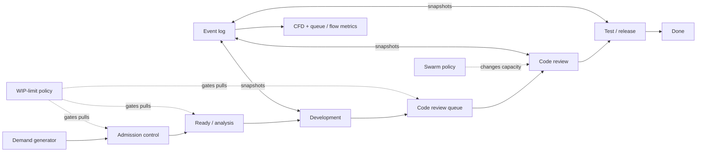

# Product-Flow Simulation Engine — Concept and Development Plan

## Purpose

Create a repeatable, scenario-based simulator of a product-development workflow. It should make the consequences of policy decisions visible in a cumulative flow diagram (CFD): where work accumulates, why it accumulates, whether an intervention clears it, and the trade-offs in throughput and cycle time.

The supplied material is used as domain reference, not as instructions. It motivates the CFD interpretation below: lane width is WIP/queue, arrival and departure slopes represent demand and delivery rate, and Little’s Law provides a cross-check between WIP, throughput, and average time in system.

## Product concept

### Core user journey

1. Select a baseline system with intentionally uneven capacity and variability.
2. Run it for a specified horizon, with a fixed random seed or many replications.
3. Inspect the CFD, stage queues, throughput, and lead-time distribution.
4. Clone the baseline and apply one or more interventions.
5. Compare the scenario CFDs and quantified trade-offs in a common time window.

The default baseline should make the teaching effect obvious rather than pretend to be a calibrated organization:

| Flow state | Nominal capacity | Typical processing time | Intended effect |
|---|---:|---:|---|
| Ready / analysis | 10 items/week | 0.8 days | Keeps intake flowing |
| Development | 7 items/week | 2.0 days | Moderate upstream capacity |
| Code review | 3 items/week | 1.5 days | Primary bottleneck and growing queue |
| Test / release | 6 items/week | 1.0 day | Clears work once review finishes |

Demand should average about 6 items/week, but vary by day and include occasional batches. This lets the review queue build despite demand that is near the system’s eventual capacity. Arrival rate, service-time variation, blocked-work probability, team calendars, and routing are all configuration values—not constants embedded in the simulator.

### Interventions to model first

| Intervention | Simulation rule | Expected CFD signature | Important caveat |
|---|---|---|---|
| Swarm at bottleneck | When review WIP exceeds a threshold, temporarily move named capacity from another stage to review until a duration or exit threshold is reached. | Review lane contracts; its downstream boundary steepens while the swarm is active. | Moving people has a ramp-up penalty and may slow the donating stage. |
| Per-stage WIP limit | Do not pull a new item into a stage when its in-progress count has reached the limit. Keep the item in its upstream ready state. | The limited stage’s band is capped; upstream/ready work becomes visible instead of being disguised as in-process work. | A limit alone does not add capacity; throughput can fall if it is set below the true operating need. |
| System WIP / CONWIP limit | Admit new work only when total active work is below a cap. | Total active CFD height is bounded; the external backlog may rise. | Backlog must be displayed separately so work has not merely “disappeared.” |
| Combined pull + swarm | Apply WIP gates continuously and a temporary swarm at the designated bottleneck. | More stable bands, then a controlled narrowing of the bottleneck. | Compare after a warm-up period; short-term clearing is not sufficient evidence. |

An intervention schedule is time-based or event-based. For example: “at day 35, swarm review with two developers for 10 working days,” or “start a swarm whenever review WIP is over 12; stop it when it drops below 6.”

## Simulation design

Use a discrete-event simulation (DES), not a spreadsheet-style aggregate model. Individual work items are needed to calculate wait time, service time, rework, blockers, and percentiles faithfully.

### Entities and state

- **Work item:** ID, type/class of service, arrival time, per-state enter/start/exit timestamps, remaining effort, blocked state, rework count, and completion time.
- **Workflow stage:** ready queue, active work, WIP limit, staffing/capacity calendar, service-time distribution, queue discipline, and optional routing probabilities.
- **Resource pool:** people/capacity assigned to stages; a swarm reassigns a portion, subject to a learning/ramp-up rule.
- **Policy:** admission, pull/gating, priority/expedite, swarming triggers, and stop conditions. Policies produce decisions; they do not manipulate queues directly.
- **Event types:** arrival, pull/start, service complete, unblock, rework, capacity change, and daily snapshot. Every state transition is recorded immutably.

The engine advances to the next event time, applies the policy, starts every eligible item that has capacity, and records the resulting transitions. It must process simultaneous events in a documented order: completions, policy updates, admission, then starts. That avoids artificial capacity starvation at a time boundary.

### Fidelity choices for version 1

- Time resolution: continuous event times, presented in working days; configurable weekday calendar.
- Demand: Poisson or scheduled/batched arrivals; default seed ensures a repeatable lesson.
- Service: log-normal or gamma distributed effort with optional per-item size classes.
- Queues: FIFO by default, with a separately flagged expedite class only if enabled.
- Blockers/rework: optional, off in the first explanatory baseline; enable in sensitivity tests.
- Warm-up: discard a configurable early interval from performance summaries, but retain it in the CFD when explaining queue formation.

## CFD and analysis design

The primary chart is a stacked-area CFD. For every day (or selected bucket), it counts items in each visible delivery state from the immutable event log. The stack order is stable: Done, Test/release, Code review, Development, Ready. A user may optionally overlay cumulative admitted and completed lines for the arrival/departure reading in the source material.

The chart must show the following clearly:

- **Width of a state band:** items in that state/queue at that instant.
- **Widening band:** arrivals into the stage exceed departures; likely constraint or variability effect.
- **Boundary slope:** observed flow rate through the relevant boundary.
- **Intervention marker:** vertical, labeled rules at swarm starts/stops or WIP-policy changes.
- **External backlog:** a separate band or companion panel, never hidden by a system WIP limit.

Each scenario also reports median and 85th/95th percentile cycle time, throughput, average and maximum WIP by state, queue wait vs. service time, blocked time, completion count, and Little’s-Law checks. The check reports both values rather than assuming equality in a transient run:

`observed mean WIP` compared with `throughput × mean time in system`.

For comparisons, use the same demand realization and seed across paired scenarios (common random numbers). This makes a CFD difference attributable to the policy instead of random arrival noise. Run at least 30 independent replications for a decision view and present a confidence interval for outcome deltas.

## Interface concept

One scenario workspace is sufficient initially:

1. **Scenario strip:** Baseline, Swarm review, Review WIP limit, Combined. Each is a clone with a visible policy summary.
2. **Primary CFD:** Selected scenario or aligned small multiples; state legend and intervention annotations.
3. **Controls:** arrival pattern, stage capacities/distributions, per-stage and system WIP limits, swarm source/target/trigger/duration, seed, horizon, and replication count.
4. **Inspector:** hover/click a date to show WIP per state, cumulative arrivals/departures, and age of the oldest item.
5. **Comparison summary:** differences versus baseline for throughput, cycle-time percentiles, max queue, and total queue-days.

The UI should label results as simulated and distinguish *queue* (waiting) from *active work*. It should not treat all “in progress” items as queue-free.

## Delivery plan

### Phase 0 — Specify the teaching baseline (1–2 days)

- Agree on states, working calendar, demand level, bottleneck location, and intervention semantics.
- Produce a deterministic reference trace: 10–20 hand-checkable items and expected daily state counts.
- Define the outcome contract: what counts as “better” (e.g., lower p85 cycle time without reducing completion throughput).

**Exit criterion:** a stakeholder can predict why each baseline CFD band widens or narrows.

### Phase 1 — Simulation kernel and traceability (3–5 days)

- Implement event scheduler, item/stage/resource models, FIFO queues, capacity calendars, timestamped event log, and seeded randomness.
- Implement daily snapshotting and machine-readable scenario configuration.
- Implement baseline, static stage capacities, demand variation, and a repeatable initial bottleneck.

**Exit criterion:** deterministic seed reproduces the exact transition and snapshot log; the hand-checkable trace agrees item by item.

### Phase 2 — CFD and metrics (2–4 days)

- Generate stacked CFD data directly from events/snapshots.
- Build arrival/departure overlays, state band labels, intervention markers, and data export.
- Compute throughput, WIP, queue waiting, service time, cycle-time percentiles, and Little’s-Law reconciliation.

**Exit criterion:** chart state counts equal the independent daily snapshot table and no item is counted in two states.

### Phase 3 — Policies and scenario comparison (3–5 days)

- Add per-stage/system WIP gating and clear external-backlog behavior.
- Add event-triggered and time-triggered swarming with source-stage capacity loss and ramp-up costs.
- Add scenario cloning, paired seeds, aligned comparison CFDs, and replication summaries.

**Exit criterion:** canned scenarios show the expected mechanisms: swarm temporarily raises bottleneck departure rate; a WIP limit caps stated WIP and shifts constrained work upstream/backlog.

### Phase 4 — Hardening and calibration (3–5 days)

- Add blockers, rework, service classes, calendar exceptions, and sensitivity runs only after core behavior is trusted.
- Import anonymized historical arrival/completion timestamps if desired; calibrate distributions and compare model to actual CFD.
- Document assumptions, limitations, and default lesson scenarios.

**Exit criterion:** baseline and calibrated configurations remain reproducible; uncertainty is visible rather than overclaimed.

## Verification strategy

| Layer | Verification | Acceptance signal |
|---|---|---|
| Event engine | Unit tests for event ordering, capacity release, queue FIFO behavior, WIP gates, and resource reassignment. | No item duplicates, losses, negative capacity, or WIP-limit breach. |
| Conservation | Property tests over many random seeds. | `arrived = completed + active + external backlog + cancelled` at every snapshot. |
| Time accounting | Item-level timestamp assertions. | Cycle time = queue wait + service + blocked time (within stated overlap convention). |
| CFD correctness | Reconstruct daily counts independently from state transitions. | Every CFD band matches snapshots; stack total equals active WIP. |
| Queueing sanity | Controlled stable and overloaded cases. | Stable case settles; overloaded case has a widening queue; increased bottleneck capacity raises its departure slope. |
| Little’s Law | Long, stable simulations plus warm-up removal. | Mean WIP and throughput × mean lead time converge within a documented tolerance. |
| Intervention causality | Paired-seed A/B tests and 30+ replications. | Effect direction and uncertainty match the policy mechanism, not a single lucky run. |
| Visual QA | Screenshot tests at desktop and narrow widths, plus tooltip/keyboard checks. | States, axes, legends, labels, and intervention markers remain readable and truthful. |

## Initial acceptance scenarios

1. **Baseline:** code review capacity is lower than incoming work. Its CFD band widens and completion slope plateaus near review capacity.
2. **Swarm:** at review WIP > 12, two developers help review for 10 days after a one-day ramp-up. The review band narrows; development may grow modestly because it supplied the people.
3. **WIP limit:** development limit = 6 and review limit = 5. Active WIP is bounded, but ready/backlog work is explicitly visible; median and tail cycle time are compared with the baseline.
4. **Combined:** WIP limits control replenishment and a limited swarm clears an exceptional review buildup. It should be judged on p85 cycle time, throughput, and queue-days—not the prettiness of a single CFD.

## Decisions to make before implementation

- Will the first release teach generic flow mechanics only, or be calibrated against a team’s historical data?
- Which workflow states are meaningful to the intended users, and should “blocked” be a state or an attribute?
- Is a swarm a temporary capacity pool, or does it remove named people from a donor stage?
- Are WIP limits enforced at *start*, *entry*, or both—and should system WIP include blocked work?
- What trade-off constraints are non-negotiable: no throughput loss, no donor-stage service-level breach, or a maximum staffing cost?

## Recommended v1 decisions

These decisions are intentionally narrow. They create a credible learning simulator before attempting to reproduce the complexity of a particular organization.

| Decision | Recommended v1 choice | Reason |
|---|---|---|
| Product intent | Generic flow-learning laboratory; historical-data calibration is a later release. | It keeps the first version testable and avoids presenting illustrative parameters as forecasts. |
| Baseline type | Recoverable congestion, not permanent overload: demand averages 4.0 items/week; review normally supplies 4.5 items/week but drops to 2.0 for a 15-working-day capacity incident. Development and test each supply 5.5 items/week. | The review band widens visibly, then can genuinely narrow after capacity returns or a swarm. A permanently overloaded base case remains a separate stress scenario. |
| States in CFD | External backlog (companion panel), Ready/analysis, Development, Code review, Test/release, Done. A state band contains both waiting and active items; the inspector splits them. | The CFD stays readable while the model still distinguishes queue time from service time. |
| Blocked work | Attribute on the item, retained in its current delivery state; show blocked time in metrics and add a separate blocked overlay only in advanced mode. | It does not hide WIP or create a confusing extra workflow column in the first CFD. |
| WIP semantics | A per-stage limit gates entry into the destination state and counts waiting + active + blocked items there. System WIP counts every non-done item admitted to the workflow, including blocked work, but excludes external backlog. | This is a pull-system rule with no invisible work. When a downstream limit is full, work remains visibly upstream. |
| Swarm semantics | Reassign capacity from Development to Code review for a fixed 10 working days, after a one-day ramp-up at 75% effectiveness. Development loses the same capacity while the swarm is active. | It represents the cost of swarming and prevents the misleading assumption that extra capacity appears for free. |
| Swarm trigger | Time-scheduled in v1 (start on working day 45); event-triggered thresholds are phase-3 scope. | A scheduled intervention is easy to explain, reproduce, and test. It isolates policy effect before adding feedback-control behavior. |
| Starter limits | Development limit = 6; Review limit = 6; system limit off by default, with a 16-item comparison scenario. | These values make the queue-shifting effect legible without preventing all flow; they will remain editable rather than treated as universal advice. |
| Experiment design | 120 working days, 20-day warm-up for summary metrics, paired demand streams, 30 independent replications per scenario. | It supports both a readable single-run CFD and defensible aggregate comparisons. |
| Decision rule | Prefer lower p85 cycle time while keeping mean throughput non-inferior (lower 95% CI no worse than 95% of baseline). Flag a donor-stage queue-day increase above 20%. | It avoids rewarding an attractive CFD that merely moves delay elsewhere or reduces completions. |

### Explicitly deferred from v1

- Calibration against an organization’s historical data and any claim of predictive accuracy.
- Named individuals, skill matrices, multitasking, and personnel cost modelling.
- Expedite classes, priorities, blocked-state CFD lane, rework routing, and event-triggered swarm control.
- Optimization or automated recommendations. The first product explains trade-offs; it does not prescribe a policy.
